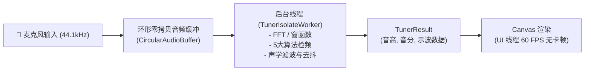

# Tuner (Flutter)

[](https://github.com/huzongyao/Tuner/actions)
[](COPYING)
[](https://flutter.dev)
[](https://dart.dev)
[](test/)
[](lib/l10n/)

**Tuner** 是一款基于 Flutter、Dart 与 Material Design 3 构建的高精度现代声学乐器与半音调音器应用。

本项目源于开源 Android 调音器 [daniel-freiermuth/Tuner](https://github.com/daniel-freiermuth/Tuner)（`feature/advanced-pitch-algorithms` 分支），通过渐进式重构（Progressive Refactoring）完成软件架构重建、声学数字信号处理（DSP）纯 Dart 化、多线程 Isolate 隔离、16 语种国际化与全量功能体验升级。

---

## 🌟 核心特性 (Key Features)

### 1. 纯 Dart 工业级声学 DSP 引擎 (Pure Dart DSP)
- **多引擎音高检测体系**:
  - **Classic**: 基于时间域 FFT 自相关（Autocorrelation）与相位声码器（Phase Vocoder）插值。
  - **Hybrid Jacobsen**: 引入 3-bin 复数 FFT 雅可比谱峰插值，根除高音区的整点频段相位突变。
  - **MPM (McLeod Pitch Method)**: 采用归一化平方差函数（NSDF）结合动态第一峰值阈值截断，彻底消除低频与吉他低音弦的八度下翻/倍频误判。
  - **TWM (Two-Way Mismatch)**: 评估谐波频谱误差与不谐和度（Inharmonicity），在基频微弱或缺失（Missing Fundamental）的复杂声学场景下表现卓越。
  - **pYIN**: 概率连续性隐马尔可夫模型（HMM）多候选状态平滑追踪。
- **声学计权与噪声消除**:
  - **IEC 61672 A-Weighting / C-Weighting**: 模拟人耳等响度曲线，深度抑制 50Hz/60Hz 工频市电嗡嗡声与空调风噪。
  - **起音八度突跳门禁 (Attack Octave Jump Gate)**: 压制小提琴运弓擦弦（Bow-scratch）瞬态高次谐波跳动，避免调音圆点在起音时飞出屏幕。
  - **抗抖动三抽头中值滤波 (Anti-Jitter Median Filter)**: 在移动平均前置过滤单采样点随机尖峰，平滑高频且不引入响应延迟。

### 2. 深厚乐理与历史律制体系 (Music Theory & Temperaments)
- **多维度均分律 (EDO)**: 内置标准十二平均律（12-EDO），并原生支持 5-EDO 至 72-EDO 任意微音程等分八度。
- **19 种历史名家良律 (Historical Well-Temperaments)**:
  - 毕达哥拉斯律 (Pythagorean)
  - 纯律 (Just Intonation / 5-limit)
  - 中庸全音律族 (1/3、1/4、1/5 柯玛中庸律)
  - 威克麦斯特系列 (Werckmeister III, IV, V, VI)
  - 克恩伯格系列 (Kirnberger 1, 2, 3)
  - 奈德哈特系列 (Neidhardt 1, 2, 3)
  - 瓦洛蒂律 (Valotti) 与 扬氏律 (Young 2)
- **Scala (.scl) 律制互通**: 遵循国际微音程标准，支持导入与解析自定义 Scala 律制文件。
- **Railsback 延展调音曲线**: 内置 32 采样点钢琴声学刚度拉尔斯贝克修正，结合三次样条（Cubic Spline）连续插值。

### 3. 双视口声学工作台 (Dual Viewports)
- **乐器调音视图 (Instrument Tuner)**:
  - 支持吉他（6弦）、贝斯（4/5弦）、尤克里里、小提琴、中提琴、大提琴等多种预置乐器，琴弦侧边栏直观指示弦粗细与目标音。
  - 对数音高历史曲线实时跟随，动态平滑渲染。
  - 三态音准状态横幅（准、偏高、偏低）搭配自适应方向提示三角。
- **科学实验室示波视图 (Scientific View)**:
  - **实时 FFT 功率谱图 (Spectrum Plot)**: 带有前 8 阶谐波位置标记与主峰频率指示。
  - **时间域自相关曲线 (Autocorrelation Plot)**: 显示滞后函数 $R_{xx}(\tau)$ 与周期定位点。
  - **Simon Tatham Gonville 矢量五线谱**: 支持高音谱号、低音谱号、中音谱号与大谱表（Grand Staff），完美绘制调号与临时变音记号。
  - **WAV 无损音频快照导出**: 环形内存缓冲快照一键保存为标准 16-bit PCM / 32-bit Float WAV 音频文件。

### 4. 22 项全量偏好配置与 16 语种国际化 (Preferences & 16-Language i18n)
- **16 种原生语言全覆盖**: 英语 (`en`)、简体中文 (`zh`)、德语 (`de`)、法语 (`fr`)、西班牙语 (`es`)、葡萄牙语 (`pt`)、波兰语 (`pl`)、罗马尼亚语 (`ro`)、匈牙利语 (`hu`)、乌克兰语 (`uk`)、捷克语 (`cs`)、加泰罗尼亚语 (`ca`)、布列塔尼语 (`br`)、瑞典语 (`sv`)、越南语 (`vi`)、阿拉伯语 (`ar`，支持原生 RTL 从右向左排版)。
- **全方位偏好微调**:
  - 主题外观切换（跟随系统、深色模式、浅色模式）。
  - 屏幕常亮（Keep screen on）Wakelock 控制。
  - A4 基准音标定（可调 415Hz ~ 466Hz）。
  - 音名记号（C-D-E、Do-Re-Mi 唱名）与八度符号（科学记号法 $C_4$、赫尔姆霍茨记法 $c'$）。
  - 检频灵敏度、容差范围（$\pm 1\sim 20$ 音分）、降号优先显示。
  - 一键出厂默认重置（Reset all settings）。

---

## 🏛 架构设计 (Architecture)

应用遵循 **Clean Architecture** 分层体系与 **Riverpod** 响应式状态管理：

```
lib/
├── audio/            # 音频流抽象层 (RecordAudioSource, 环形缓冲区, WAV 录制导出, 权限管理)
├── core/             # 基础设施 (Material 3 主题、声学常量、国际化适配)
├── domain/           # 乐理与领域实体 (MusicalNote, 19种律制, 弦乐器配置, Railsback, Preferences模型)
├── dsp/              # 纯 Dart DSP 计算引擎 (RealFFT, 自相关, MPM, TWM, Jacobsen, Filters, Isolate Worker)
├── l10n/             # 16 语种 ARB 字典与自动代码生成的 AppLocalizations
├── state/            # Riverpod 状态提供者 (音频流控制器, 调音器评估, 偏好管理, 示波器快照)
└── ui/               # 视图呈现层 (Instrument/Scientific/Settings 页面, 自定义 Canvas 图表, 弹窗)
```

### 多线程后台音频流水线 (Isolate Audio Pipeline)



---

## 🚀 快速上手 (Getting Started)

### 环境依赖
- [Flutter SDK](https://docs.flutter.dev/get-started/install): `^3.22.0` (推荐 `3.24+`)
- [Dart SDK](https://dart.dev/get-dart): `^3.4.0`
- [JDK](https://adoptium.net/): 17
- Android SDK: `compileSdk = 37`

### 安装与运行

1. **获取代码与依赖**:
   ```bash
   cd tuner_flutter
   flutter pub get
   ```

2. **本地生成国际化文件**:
   ```bash
   flutter gen-l10n
   ```

3. **运行在连接的设备或模拟器**:
   ```bash
   flutter run
   ```

4. **构建 Release 分包 APK**:
   ```bash
   flutter build apk --release --split-per-abi
   ```
   输出 APK 位于 `build/app/outputs/flutter-apk/`:
   - `app-arm64-v8a-release.apk`
   - `app-armeabi-v7a-release.apk`
   - `app-x86_64-release.apk`

---

## 🧪 自动化测试与质量门禁 (Testing & CI)

项目配置了严苛的代码风格规范与多层级测试用例，CI 保证所有提交绿色可靠：

```bash
# 1. 代码格式化校验
dart format --output=none --set-exit-if-changed .

# 2. 静态代码分析
flutter analyze

# 3. 运行全量 121 项自动化测试
flutter test
```

### 测试矩阵分布
- `test/dsp/`: RealFFT 精度、自相关算法、MPM/TWM/Jacobsen 算法基准、A/C 声学计权曲线、中值滤波器与脉冲抑制。
- `test/domain/`: 12-EDO、微音程律制、19 种历史律制数学换算、Scala SCL 语法解析、Railsback 样条插值。
- `test/audio/`: 环形缓冲区零拷贝回卷、PCM/Float32 编码、WAV 头结构生成、音频采集安全释放。
- `test/staff/`: Gonville 矢量音符排版、高低音谱号基准线、调号升降号定位。
- `test/widget/`: 乐器主界面、科学示波屏、设置界面交互与弹窗。
- `test/preferences/`: 偏好持久化、出厂重置与 DSP 双向响应联动。
- `test/l10n/`: 16 语种加载完整性、占位符复数与阿拉伯语 RTL 适配。

---

## 📄 开源许可与致谢 (License & Credits)

- **软件代码许可**: 本项目继承源项目，采用 [GNU General Public License v3.0 (GPLv3)](COPYING) 开源。
- **原版 Android Kotlin Tuner**: 感谢 [Daniel Freiermuth](https://github.com/daniel-freiermuth) 开创的优秀基石项目。
- **Gonville 音乐符号字体**: 五线谱符号由 [Simon Tatham](https://www.chiark.greenend.org.uk/~sgtatham/gonville/) 设计创作，保留其专用自由软件许可。
