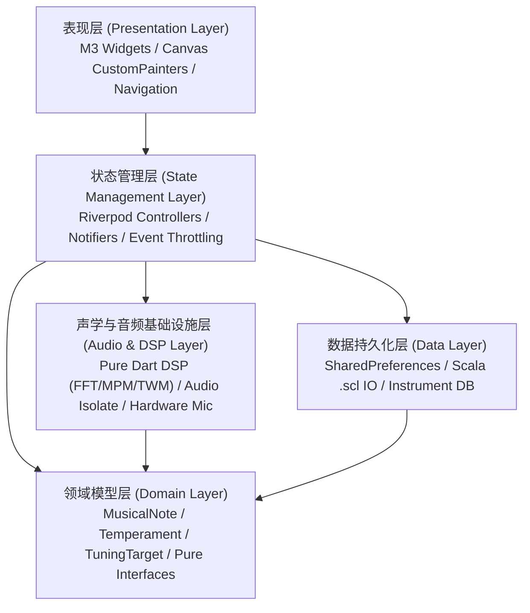
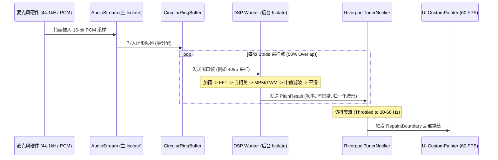

# Flutter Tuner 现代化软件架构设计规范 (Clean Architecture)

> **目标版本**: Flutter 3.44.6 / Dart 3.12.2 / Material Design 3  
> **设计哲学**: 严格单向数据流、纯 Dart 声学算法引擎高内聚、平台音频流与多线程 Isolate 隔离、高频音高事件防抖节流。

---

## 一、系统架构分层设计

应用采用清晰的四层分层架构，各层之间单向依赖，核心计算引擎不依赖任何 Flutter UI 框架组件：



### 1. 核心目录与模块职责

```text
lib/
├── core/                              # 跨模块通用支撑
│   ├── constants/                     # 声学、物理与数学常量 (AcousticConstants)
│   ├── theme/                         # Material 3 主题令牌、调色板扩展 (TunerTheme, TunerColors)
│   └── utils/                         # 纯函数数学与位运算辅助
├── domain/                            # 领域业务核心 (纯 Dart，0 外部插件依赖)
│   ├── models/                        # 音符 (MusicalNote)、调音目标 (TuningTarget)、调音状态 (TuningState)
│   ├── temperaments/                  # 12-EDO、微音程 EDO 5-72、19 种历史良律基类与定义
│   └── stretch_tuning/                # Railsback 五次多项式钢琴延展调音算法模型
├── dsp/                               # 纯 Dart 信号处理引擎库 (纯数学计算，可在 Isolate 独立运行)
│   ├── fft/                           # Radix-2 Cooley-Tukey 实数/复数快速傅里叶变换
│   ├── correlation/                   # 零填充频域互相关与自相关波形生成器
│   ├── pitch/                         # 多算法检测器 (Classic, Jacobsen, MPM, TWM, pYIN)
│   ├── filters/                       # 窗函数 (Hanning/Hamming)、声学计权 (A/C)、中值滤波、跳度门控
│   ├── post_processing/               # 离群点剔除多环形缓冲区平滑器 (OutlierRemovingSmoother)
│   └── tuner_dsp_pipeline.dart        # 调音管线门面 (Facade)，统一调度输入帧、检测器、滤波与平滑
├── audio/                             # 音频采集与并发管理
│   ├── audio_source_interface.dart    # 硬件音频采集器抽象接口
│   ├── hardware_audio_stream.dart     # 基于平台插件或平台通道的 16-bit PCM 44.1kHz 录音流
│   ├── circular_ring_buffer.dart      # 生产者-消费者无锁环形采样缓冲队列
│   └── audio_isolate_controller.dart  # Dart Isolate 后台音频运算隔离控制器
├── data/                              # 数据访问与持久化
│   ├── preferences/                   # SharedPreferences 包装器与偏好设置仓储
│   ├── scala_io/                      # Huygens-Fokker Scala (.scl) 格式解析与导出
│   └── instruments/                   # 预设乐器库与用户自定义乐器持久化存储 (JSON / SQLite)
├── state/                             # Riverpod 状态控制器
│   ├── tuner_state_notifier.dart      # 实时调音核心状态 (当前频率、目标音符、音分偏差、波形快照)
│   ├── preferences_provider.dart      # 全局设置项响应式 Provider
│   └── instrument_provider.dart       # 当前选择乐器与琴弦目标状态机
└── ui/                                # Material 3 视觉表现层
    ├── screens/                       # 乐器调音主屏、科学示波器屏、偏好设置屏
    ├── widgets/                       # 琴弦侧栏、三态圆点、偏差表盘、五线谱展示
    ├── plot/                          # Canvas 音高历史图、FFT 功率谱图、自相关曲线图
    └── dialogs/                       # A4 基准调节、律制选择、算法切换、Scala 文件导入对话框
```

---

## 二、端到端实时数据流向与线程隔离

为了避免音频 DSP 计算阻塞 UI 主线程导致的掉帧与手势顿挫，应用设计了严格的多线程隔离架构：



---

## 三、高频渲染防抖与重绘隔离规范

1. **RepaintBoundary 独立层隔离**:
   - 示波器波形、FFT 功率谱与音高历史图必须包裹在独立的 `RepaintBoundary` 中，禁止高频波形重绘触发整个页面或父级 Widget 的 `build()`。
2. **`shouldRepaint` 精确判定**:
   - `CustomPainter` 的 `shouldRepaint` 必须对当前数据版本号（Frame ID）或数值变化进行精确比对，数值微小未变时直接返回 `false`。
3. **状态节流 (Throttling)**:
   - 即使后台音频每秒处理 86 帧（50% 重叠率），UI 状态流也应经过时间节流阀（控制在 30-60 FPS），防止低端设备 UI 消息通道过载。
4. **生命周期自动挂起**:
   - 监听 `AppLifecycleState`：应用退到后台、被覆盖或锁屏时，立即发送暂停信号停止音频捕获与 Isolate 计算；恢复前台时平滑重启。
