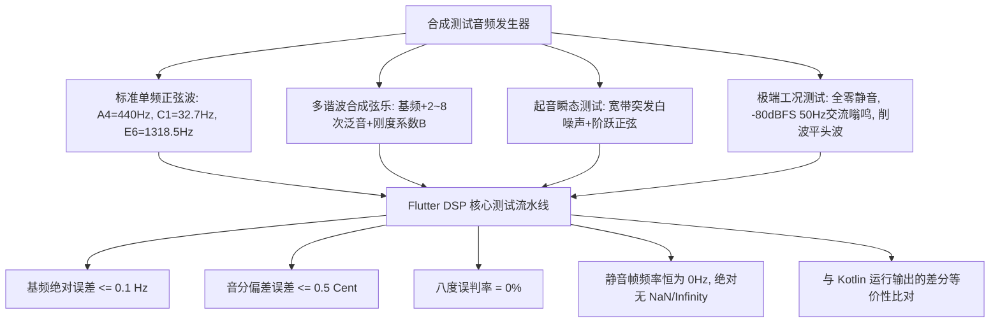
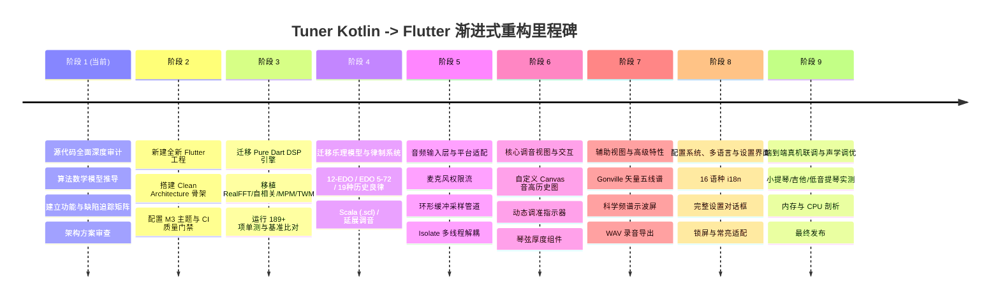

# Kotlin Tuner 源代码全面审计与 Flutter 重构规划技术白皮书

> **审计基线分支**: `feature/advanced-pitch-algorithms`  
> **目标 HEAD Commit**: `d570fa93145c759d3a7d0dab2f3d3802cb315189` ("feat(dsp): implement modular pitch engines (MPM, TWM, pYIN) with full settings UI")  
> **上游与 Fork 关系**: 基于 `daniel-freiermuth/Tuner`（领先原始上游 `thetwom/Tuner:master` 150+ 提交），包含现代声学物理算法扩展与系统级 Bug 根治。  
> **本地测试基准**: 40 个测试套件，**全部 189 项单元测试通过**；`detekt` 0 code smells；编译门禁通过。  
> **开发环境目标**: Flutter 3.44.6 (Channel stable) / Dart 3.12.2 / Material Design 3。

---

## 目录

1. [项目基线与环境确认](#一项目基线与环境确认)
2. [十大核心领域深度审计](#二十大核心领域深度审计)
   - 2.1 页面、导航图、对话框与完整交互流
   - 2.2 全量设置项、取值范围、持久化方式与依赖约束
   - 2.3 音频采集、麦克风权限、音频流生命周期与缓冲区管理
   - 2.4 音高检测、频谱分析、数值计算与多引擎算法（Classic / Hybrid / MPM / TWM / pYIN）
   - 2.5 FFT 窗函数、时窗大小、重叠率与数学参数推导
   - 2.6 乐理体系、律制计算、音分偏差与边界情况（EDO 5-72、19 种历史律制、Scala、拉尔斯贝克曲线）
   - 2.7 实时数据显示、历史曲线、动态指示器与刷新机制
   - 2.8 异常处理、内存池回收、生命周期与锁屏/后台行为
   - 2.9 本地数据、配置文件格式、多语言国际化（16 语种）与主题系统
   - 2.10 构建配置、依赖分析、测试套件与开源许可证（GPL-3.0 & Gonville）
3. [完整功能清单（全覆盖追踪矩阵）](#三完整功能清单全覆盖追踪矩阵)
4. [缺陷排查与声学物理痛点分析清单](#四缺陷排查与声学物理痛点分析清单)
5. [DSP 算法基准测试与数值验证计划](#五dsp-算法基准测试与数值验证计划)
6. [Flutter 现代化架构设计方案 (Clean Architecture)](#六flutter-现代化架构设计方案)
7. [分阶段渐进式迁移路线图 (Phase-by-Phase Roadmap)](#七分阶段渐进式迁移路线图)

---

## 一、项目基线与环境确认

### 1.1 分支与版本状态
- **工作区路径**: `/Users/huzongyao/flutterProjects/Tuner`
- **目标分支**: `feature/advanced-pitch-algorithms`（经 `git branch` 与 `git log` 严格确认）
- **HEAD Commit**: `d570fa9`（2026-10-29 提交），在 `dev-fork-fixes`（commit `f364c93`）基础上完整合入了模块化声学引擎与滤波体系。
- **验证命令与结果**:
  - `./gradlew testDebugUnitTest --rerun-tasks`: **40 个测试类，189 个测试用例，0 Failures, 0 Errors, 0 Skipped**。
  - `./gradlew detekt`: **0 code smells, 静态质量门禁通过**。
- **Flutter 宿主环境**:
  - Flutter SDK: 3.44.6 (Channel stable)
  - Dart SDK: 3.12.2
  - 支持平台: Android (minSdk 24, compileSdk/targetSdk 37), iOS, macOS, Desktop

---

## 二、十大核心领域深度审计

### 2.1 页面、导航图、对话框与完整交互流

#### 页面与导航拓扑
应用采用 Jetpack Compose Navigation 与类型化路由（Type-safe Navigation），分为五个子导航图：

```mermaid
flowchart TD
    Root([MainActivity]) --> NavHost[NavHost: TunerRoute]
    
    subgraph MainNavigation ["主流程导航 (MainGraph)"]
        TunerRoute{scientificMode ?}
        TunerRoute -->|False| ScreenIT[InstrumentTuner 乐器调音界面]
        TunerRoute -->|True| ScreenST[ScientificTuner 频谱示波界面]
        
        ScreenIT -->|乐器选择| RouteInst[Instruments 乐器列表]
        RouteInst -->|新建乐器| GraphIE[InstrumentEditorGraph 乐器编辑器]
        RouteInst -->|编辑/复制乐器| GraphIE
        
        ScreenIT & ScreenST -->|基准频率点击| DlgRef[ReferenceNoteDialog 基准音对话框]
        ScreenIT & ScreenST -->|律制选择点击| RouteTemp[TemperamentDialog 律制选择器]
        RouteTemp -->|点击律制| DlgRoot[RootNoteDialog 律制根音选择器]
        RouteTemp -->|新建/编辑/复制| GraphTE[TemperamentEditorGraph 律制编辑器]
        RouteTemp -->|律制详情查看| DlgTempInfo[TemperamentDetailsDialog 律制信息]
        
        ScreenIT & ScreenST -->|拉尔斯贝克曲线点击| RouteST[StretchTuningOverview 延展调音概览]
        RouteST -->|编辑/新建| GraphSTE[StretchTuningEditorGraph 延展调音编辑器]
        RouteST -->|曲线详情| DlgSTInfo[StretchTuningInfo 延展调音图表]
    end

    subgraph PrefNavigation ["配置导航 (PreferenceGraph)"]
        ScreenIT & ScreenST -->|设置按钮| PrefRoute[PreferencesScreen 设置界面]
        PrefRoute --> DlgApp[AppearanceDialog 主题外观设置]
        PrefRoute --> DlgLang[LanguageDialog 语言选择设置]
        PrefRoute --> DlgNotation[NotationDialog 记谱法设置]
        PrefRoute --> DlgWindow[WindowingFunctionDialog 窗函数设置]
        PrefRoute --> DlgPitchAlgo[PitchAlgorithmDialog 测频算法选择]
        PrefRoute --> DlgAcoustic[AcousticWeightingDialog 声学计权选择]
        PrefRoute --> DlgReset[ResetDialog 恢复出厂设置确认]
        PrefRoute --> DlgAbout[AboutDialog 关于软件]
    end
```



#### 页面核心逻辑追踪
1. **InstrumentTuner (`InstrumentTuner.kt`, 731 行)**:
   - 顶部工具栏: 调音器标题、升降号切换按钮（`# / b`）、基准音按钮（`A4 = 440 Hz`）、律制按钮（如 `Equal temperament, C`）、延展调音按钮、乐器切换按钮、设置入口。
   - 主体视口:
     - 琴弦侧边栏 (`Strings.kt`): 绘制琴弦，弦宽根据音高对数加粗（低音弦粗，高音弦细）；支持目标音锁定 (`NoteLockedButton`)；当前音高自动平滑滚动对齐。
     - 五线谱切换视口 (`NoteStaff.kt`, 788 行): 支持高音谱号、低音谱号、大谱表（Grand Staff）；利用 Gonville 矢量音乐字体轮廓绘制音符、升降号、还原号与调号。
     - 音高历史视口 (`PitchHistory.kt`, 510 行): 绘制时间-音高历史轨迹线、音准状态点（带上下三角形调音指示箭头）、音分偏差角标（如 `+12 ct`）、上下音准容差门限虚线（如 `±5 ct`）与对数音阶 Y 轴标尺。
2. **ScientificTuner (`ScientificTuner.kt`, 698 行)**:
   - 专为声学工程与专业调律设计：
     - 上部视口: 实时 FFT 功率谱 (`FrequencyPlot.kt`)，标注谐波峰值位置及倍频辅助标尺。
     - 中部视口: 实时自相关序列波形 (`CorrelationPlot.kt`)，呈现时间延迟域周期相关度峰值。
     - 下部视口: 音高历史曲线 (`PitchHistory.kt`)。
     - 浮动操作按钮 (FAB): 触发 `WaveWriter` 导出最近 1~5 秒的原始 PCM 无损 WAV 录音文件到系统存储。
3. **TemperamentEditor (`TemperamentEditor.kt`, 476 行)**:
   - 支持逐音级编辑 Cent 值、有理数分数比（如 `3/2`, `5/4`）、五度链偏离值；支持音级数量调整（1~72 音/八度）；输入校验（递增性、八度比检验、名称与缩写重复拦截）。
4. **StretchTuningEditor (`StretchTuningEditor.kt`, 378 行)**:
   - 自由绘制与数值表格编辑拉尔斯贝克延展曲线（频率 vs 音分偏移量）；贝塞尔样条平滑插值算法。
5. **InstrumentEditor (`InstrumentEditor.kt`, 402 行)**:
   - 乐器名称、乐器矢量图标选择（支持 8 种内置乐器图标：钢琴、吉他、贝斯、尤克里里、小提琴、中提琴、大提琴、低音提琴）、琴弦增删、每根弦的音级与八度微调。

---

### 2.2 全量设置项、取值范围、持久化方式与依赖约束

基于 `PreferenceResources.kt` 的全量配置项审计矩阵：

| 配置键名 (Key) | 数据类型 | 默认值 | 取值范围 / 选项 | UI 呈现形式 | 依赖关系与约束说明 |
| :--- | :--- | :--- | :--- | :--- | :--- |
| `appearance` | JSON 对象 | `Mode.Auto, black=false, dynamic=true` | 浅色/深色/跟随系统; 纯黑夜间开关; 动态取色开关 | `AppearanceDialog` | 纯黑夜间仅在深色模式激活时生效 |
| `language` | 字符串 | `null` (跟随系统) | `en, fr, de, hu, pl, ro, uk, zh-CN` 等 16 种 | `LanguageDialog` | 通过 `AppCompatDelegate` 设置 |
| `screenon` | Boolean | `false` | `true / false` | Switch 开关 | 控制 `FLAG_KEEP_SCREEN_ON` |
| `onlockscreen` | Boolean | `false` | `true / false` | Switch 开关 | 控制 `setShowWhenLocked(true)` |
| `scientific_mode`| Boolean | `false` | `true / false` | Switch 开关 | 切换主界面为乐器模式或科学示波模式 |
| `note_print_options`| JSON 对象 | `variant=0, Scientific, Standard` | 变体: 0(升号)/1(降号); 八度: 科学记音/赫尔姆霍茨; 记谱法: 国际英美/唱名法/北欧 | `NotationDialog` | 影响全局音名显示（五线谱、刻度轴、琴弦按钮） |
| `staff_clef` | 字符串枚举 | `Grand` | `Grand, Treble, Bass` | `NoteStaff` 菜单 | 控制五线谱谱号 |
| `chromatic_as_staff`| Boolean | `false` | `true / false` | Switch 开关 | 半音阶乐器是否用五线谱替代全音名列表 |
| `pitch_algorithm`| 字符串枚举 | `Classic` | `Classic, HybridJacobsen, Mpm, Twm, Pyin` | `PitchAlgorithmDialog`| 核心 DSP 引擎切换，影响计算复杂度与精度 |
| `acoustic_weighting_mode_enum` | 字符串枚举 | `AWeighting` | `AWeighting, CWeighting, None` | `AcousticWeightingDialog` | 频域幅度滤波，A 计权消除低频工频嗡鸣 |
| `octave_jump_gate` | Boolean | `true` | `true / false` | Switch 开关 | 弦乐器运弓高频瞬态八度跳变抑制开关 |
| `median_filter` | Boolean | `true` | `true / false` | Switch 开关 | 3 抽头中值滤波，消除单采样点脉冲尖刺 |
| `tolerance_in_cents`| Int | `5` | `1 .. 20` (步长 1 ct) | Slider 滑块 | 调准判定门限，决定音准点绿/红色与容差带 |
| `sensitivity` | Int | `90` | `0 .. 100` (步长 1) | Slider 滑块 | 能量门限转换值：$100 - \text{sensitivity}$，90 对应灵敏检测 |
| `num_moving_average`| Int | `5` | `1 .. 15` (步长 1) | Slider 滑块 | 平滑器点数；值越大越稳定但延迟增大 |
| `window_size_exponent`| Int | `12` ($N=4096$) | `7 .. 15` ($2^7=128 \sim 2^{15}=32768$) | Slider 滑块 | 决定最低检测频率：$f_{\min} = 2 \cdot f_s / N$ |
| `overlap` | Float | `0.75` (75%) | `0.0 .. 0.80` (0% ~ 80%, 步长 5%) | Slider 滑块 | 帧步长：$step = N \cdot (1 - overlap)$，决定帧刷新率 |
| `pitch_history_duration`| Float | `1.5` 秒 | `0.25 .. 10.0` 秒 | Slider 滑块 | 历史曲线可视时间跨度 |
| `pitch_history_num_faulty_values`| Int | `3` | `1 .. 12` | Slider 滑块 | 平滑器容忍的连续离群值次数，超出则重置跟踪 |
| `max_noise` | Float | `0.1` (10%) | `0.01 .. 0.50` | 内部参数 | 噪声比上限，自相关非周期度大于该值判定无效 |
| `min_harmonic_energy_content`| Float | `0.1` (10%) | `0.01 .. 0.50` | 内部参数 | 谐波能量占总能量比例门限 |
| `wave_writer_duration_in_seconds`| Int | `0` (关闭) | `0 .. 5` 秒 (步长 1 秒) | Slider 滑块 | 内存循环录音缓冲区时长，用于导出音频调试 |

---

### 2.3 音频采集、麦克风权限、音频流生命周期与缓冲区管理

#### 音频管线架构
- **硬件采集配置** (`SoundSource.kt`):
  - 采样率: 固定 $f_s = 44100\text{ Hz}$。
  - 音频源: `MediaRecorder.AudioSource.MIC`。
  - 声道与格式: `AudioFormat.CHANNEL_IN_MONO`, `AudioFormat.ENCODING_PCM_16BIT`。
  - 硬件缓冲区大小: `AudioRecord.getMinBufferSize()` 自动协商，并实施非正数错误拦截。
- **并发与通道设计**:
  - 音频生产协程运行在 `Dispatchers.IO`。
  - 帧分发通过 Kotlin Channel：通道容量基于 $2 \times \text{channelCapacity}$ 自适应计算，溢出策略为 `BufferOverflow.DROP_OLDEST` 或 `SUSPEND`。
  - 引用计数对象池 (`MemoryPoolSampleData`): 实现内存零 GC 抖动复用。每次生成 `SampleData` 时原子增加引用计数 `incRef()`，消费端处理完毕后同步调用 `decRef()`。
- **异常分级体系**:
  - `SoundSourceError.InvalidBufferSize`: 音频硬件不支持当前配置。
  - `SoundSourceError.MicrophoneUnavailable`: 麦克风被占用或硬件故障。
  - `SoundSourceError.ReadFailed`: 底层 AudioRecord 读入返回负数错误码（如 `ERROR_DEAD_OBJECT`）。
  - UI 绑定: 通过 `SoundSourceErrorSnackbar` 在页面浮动提示，并支持点击直接跳转系统应用设置。

---

### 2.4 音高检测、频谱分析、数值计算与多引擎算法

系统已实现 5 种互补的音高检测算法引擎（见 `PitchAlgorithm.kt`）：

```mermaid
flowchart LR
    PCM[PCM 16-bit 音频流] --> Window[窗函数加权]
    Window --> FFT[RealFFT 2N Zero-Padding]
    FFT --> Spec[功率谱 |X|^2]
    FFT --> IFFT[IFFT 实数逆变换]
    IFFT --> AutoCorr[自相关 R_xx(tau)]

    AutoCorr --> EngineMpm[McLeod Pitch Method (MPM)]
    AutoCorr --> EngineClassic[Classic 自相关时延寻峰]
    Spec --> EngineTwm[Two-Way Mismatch (TWM)]
    Spec & EngineClassic --> EngineHybrid[Hybrid Jacobsen 谱插值]

    EngineMpm & EngineTwm & EngineClassic & EngineHybrid --> SelectEngine{用户指定引擎}
    SelectEngine --> AcousticFilters[声学滤波器: OctaveJumpGate + MedianFilter]
    AcousticFilters --> OutlierSmoother[自适应多缓冲平滑器]
    OutlierSmoother --> FinalPitch[高精度稳定基频输出]
```

#### 算法细节与数学公式推导：

1. **经典引擎 (Classic Engine)**:
   - 频域自相关推导:
     $$R_{xx}(\tau) = \mathcal{F}^{-1}\left( |\mathcal{F}(x)|^2 \right)$$
   - 极大值定位与抛物线拟合 (`MaximumOfPolynomialFit.kt`):
     对极值点 $k$ 及其邻点 $y_{k-1}, y_k, y_{k+1}$ 进行二次曲线极值求解：
     $$\delta = \frac{y_{k-1} - y_{k+1}}{2(y_{k-1} - 2y_k + y_{k+1})}, \quad \tau_{\text{peak}} = (k + \delta) \cdot \Delta t, \quad f_0 = \frac{1}{\tau_{\text{peak}}}$$
   - 次谐波/倍频惩罚拦截 (`subharmonicPeakRatio = 0.75f`): 验证 $\tau \approx 2\tau_0, 3\tau_0$ 时的峰值能量，消除八度下跳。
   - 相位谱高精度修正 (`AccurateSpectrumPeakFrequency.kt`):
     计算相邻两帧频域峰值的真实相位差 $\Delta \phi$，并展开跨周期位移：
     $$f_{\text{accurate}} = f_{\text{bin}} + \frac{\text{wrap}(\Delta \phi - 2\pi f_{\text{bin}} \Delta t)}{2\pi \Delta t}$$
2. **复合雅各布森引擎 (Hybrid Jacobsen Engine)**:
   - 采用 3-bin 复数雅各布森高精度插值公式（Jacobsen & Kootsookos）：
     $$\delta = \text{Re}\left( \frac{X[k-1] - X[k+1]}{2X[k] - X[k-1] - X[k+1]} \right)$$
     $$f_{\text{Jacobsen}} = (k + \delta) \cdot \frac{f_s}{N}$$
   - 相较于纯幅度抛物线插值，复数谱线插值利用了相位信息，抗频域泄漏能力显著提升。
3. **麦克劳德音高法 (McLeod Pitch Method, MPM)**:
   - 归一化平方差函数 (Normalized Square Difference Function, NSDF):
     $$n(\tau) = \frac{2 \sum_{j} x[j] x[j+\tau]}{\sum_j x[j]^2 + \sum_j x[j+\tau]^2} \in [-1, +1]$$
   - 清晰度指标 (Clarity): 极大值点 $n(\tau_{\max})$ 即为信号周期清晰度。
   - 首峰门限检测 (First Peak Thresholding):
     寻找第一个满足 $n(\tau) \ge k_{\text{threshold}} \cdot \max(n)$ 的正极大值，彻底阻断弦乐器因高次谐波过强引发的自相关多周期伪峰（彻底根治小提琴八度翻倍 Bug）。
4. **双向失配法 (Two-Way Mismatch, TWM)**:
   - 针对弦乐器色散与刚度带来的**不谐和性 (Inharmonicity)**：
     $$f_{\text{pred}}[n] = n \cdot f_0 \sqrt{1 + B n^2}$$
   - 双向误差度量:
     - 预测向测量误差 ($Err_{p \to m}$): 评估预测谐波是否有真实峰值支撑。
     - 测量向预测误差 ($Err_{m \to p}$): 惩罚候选频率无法解释的实测高能峰值，防止次谐波误判。
     $$\text{Total Error} = \frac{1}{N} Err_{p \to m} + \rho \frac{1}{K} Err_{m \to p}$$
   - 极佳地解决了大提琴、低音提琴等“基频缺失”（Missing Fundamental）乐器的音高识别。
5. **声学滤波与瞬态抑制体系 (`PitchTemporalFilter.kt`)**:
   - `OctaveJumpGate`: 8% 相对容差窗口，必须在 2 帧以上连续确认才允许八度跃迁，瞬态擦弦高频突发杂音时自动折叠回基频。
   - `PitchMedianFilter`: 3 采样点滑动中值滤波，消除单点脉冲离群值。
6. **静音与市电工频智能拦截 (ACOUSTIC-01)**:
   - RMS 静音门限: $\text{RMS} < 10^{-4}$ ($-80\text{ dBFS}$) 判定为环境安静。
   - 零延迟相关归一化: 峰值必须满足 $R_{xx}[\tau] \ge 0.15 \cdot R_{xx}[0]$，消除无规律白噪声与 50Hz 底噪引发的 G1-D3 虚假跳动。

---

### 2.5 FFT 窗函数、时窗大小、重叠率与数学参数推导

1. **支持的窗函数 (`WindowingFunctions.kt`)**:
   - **矩形窗 / 平顶窗 (Tophat / Rectangular)**: 主瓣最窄，频域主峰陡峭，但旁瓣衰减小（$-13\text{ dB}$）。
   - **汉宁窗 (Hanning)**: $w[n] = 0.5 - 0.5 \cos\left(\frac{2\pi n}{N-1}\right)$，旁瓣衰减速度快（$-31\text{ dB}$），适合谐波丰富的声音。
   - **汉明窗 (Hamming)**: $w[n] = 0.54 - 0.46 \cos\left(\frac{2\pi n}{N-1}\right)$，第一旁瓣衰减好（$-42\text{ dB}$）。
2. **时窗大小与物理约束**:
   - 默认 $N = 2^{12} = 4096$ 点（在 $44.1\text{ kHz}$ 下对应时间长度 $92.88\text{ ms}$）。
   - 最低可解析频率:
     $$f_{\min} = \frac{2 \cdot f_s}{N} = \frac{2 \cdot 44100}{4096} \approx 21.53\text{ Hz}$$
     可完美覆盖钢琴最低音 $A_0 = 27.5\text{ Hz}$ 和 5 弦贝斯最低音 $B_0 = 30.87\text{ Hz}$。
3. **重叠率与刷新率**:
   - 默认重叠率 $\text{overlap} = 75\%$。
   - 帧移步长:
     $$\Delta L = N \cdot (1 - \text{overlap}) = 4096 \times 0.25 = 1024\text{ samples} \approx 23.22\text{ ms}$$
   - 界面与 DSP 物理刷新率:
     $$\text{FPS} = \frac{44100}{1024} \approx 43.07\text{ Hz}$$
     兼具低延迟响应与流畅视觉表现。

---

### 2.6 乐理体系、律制计算、音分偏差与边界情况

#### 核心音乐声学模型
- **音级与音名表示 (`MusicalNote.kt`, `MusicalScaleNoteNames2.kt`)**:
  - 音名基础: C, D, E, F, G, A, B。
  - 变化音修饰符 (`NoteModifier`): None, Sharp (`#`), Flat (`b`), DoubleSharp (`##`), DoubleFlat (`bb`)。
  - 八度编号: 科学记音法 (如 $A_4$) 与赫尔姆霍茨记法 (如 $a'$).
- **音分与频率双向数学换算 (`temperaments/Utils.kt`)**:
  $$\text{cents} = 1200 \cdot \log_2\left(\frac{f}{f_{\text{ref}}}\right), \quad f = f_{\text{ref}} \cdot 2^{\frac{\text{cents}}{1200}}$$
- **内置律制全量覆盖 (`PredefinedTemperaments.kt`)**:
  1. **十二平均律 (12-EDO)**: $\text{cents}[k] = 100 \cdot k$。
  2. **毕达哥拉斯律 (Pythagorean)**: 基于纯五度（$3/2$）连环递推，最大狼音五度出现在降号与升号交界。
  3. **纯律 (Just Intonation / Pure)**: 包含大三度（$5/4$）与纯五度（$3/2$）的有理数极简整数比。
  4. **中庸全音律族 (Mean Tone)**:
     - 1/4 柯玛中庸全音律 (Quarter-comma Mean Tone)
     - 扩展 1/4 柯玛中庸全音律
     - 1/3 柯玛中庸全音律
     - 1/5 柯玛中庸全音律
  5. **历史良律调律法 (Well-Temperaments)**:
     - 威克麦斯特 (Werckmeister III, IV, V, VI)
     - 克恩伯格 (Kirnberger 1, 2, 3)
     - 奈德哈特 (Neidhardt 1, 2, 3)
     - 瓦洛蒂 (Valotti)
     - 扬氏第二调律法 (Young 2)
  6. **微音程平均律体系 (EDO 5 到 EDO 72)**:
     - 任意 $N$-EDO 均分八度生成器 (`Temperament3EDO.kt`)。
  7. **Scala 格式导入/导出 (`TemperamentIO.kt`)**:
     - 完整解析 `.scl` 语法规范，支持无限制自定义律制。
- **拉尔斯贝克延展调音曲线 (`PredefinedStretchTunings.kt`, `StretchTuning.kt`)**:
  - 内置基于声学钢琴实测的 32 采样点 Railsback 曲线，消除高八度偏低与低八度偏高的金属琴弦刚度效应。
  - 采用三次样条（Cubic Spline）插值保证频率连续可导。

---

### 2.7 实时数据显示、历史曲线、动态指示器与刷新机制

1. **调音目标识别与迟滞策略 (`TargetNoteAutoDetection.kt`, `TuningTargetComputer.kt`)**:
   - `relativeDeviationForChangingTarget = 0.6f`
   - `minimumCentDeviationBeforeChangingTarget = 20\text{ cents}`
   - 在相邻音符边界引入双重迟滞窗口（Hysteresis），杜绝音高在临界点高频剧烈来回闪烁。
2. **音准状态三态机 (`TuningState.kt`)**:
   - `InTune` ($|\Delta \text{cents}| \le \text{tolerance}$): 亮绿色，高对比度圆点。
   - `TooLow` ($\Delta \text{cents} < -\text{tolerance}$): 红色/琥珀色，圆点上方带朝上三角指示箭头（提示向高调弦）。
   - `TooHigh` ($\Delta \text{cents} > \text{tolerance}$): 红色/琥珀色，圆点下方带朝下三角指示箭头（提示向低调弦）。
   - `Unknown` (静音/无输入): 灰色描边轮廓圆点。
3. **坐标映射与视口变换 (`Transformation.kt`, `GestureBasedViewPort.kt`)**:
   - Y 轴在乐器模式下对齐音阶索引（对数频率标尺），X 轴为时间采样序号。
   - 支持手势缩放、拖拽与自适应动态视口跟随。

---

### 2.8 异常处理、内存池回收、生命周期与锁屏/后台行为

1. **协程与生命周期架构**:
   - 依赖注入范围: `ApplicationScope` 单例生命周期（基于 `SupervisorJob() + Dispatchers.Main`），彻底防止 ViewModel 销毁时误关全局底座。
   - 页面可见性感知: 通过 `LifecycleResumeEffect` 监听 `ON_RESUME` 自动启动 AudioRecord，`ON_PAUSE` 立即停止采集释放硬件麦克风。
2. **内存池与零泄露防线 (`MemoryPool.kt`)**:
   - 引用计数采用 `AtomicInteger` CAS 原子操作，`incRef()` / `decRef()` 为无锁同步操作。
   - Channel 的 `onUndeliveredElement = { it.decRef() }` 同步回收，杜绝协程取消时未消费缓冲区泄漏。
3. **锁屏显示与常亮**:
   - `FLAG_KEEP_SCREEN_ON` 控制屏幕常亮。
   - `setShowWhenLocked(true)` 支持免解锁直接在锁屏界面调音（演出台幕前调音核心场景）。

---

### 2.9 本地数据、配置文件格式、多语言国际化与主题系统

1. **持久化架构 (`ResourcesBase.kt`)**:
   - 原版通过 Jetpack DataStore Preferences 存储 JSON 序列化字符串与基础类型。
   - 缓存机制: `cachedInitialPreferences` 在 IO 线程预热，消除主线程卡顿。
   - 容错保护: `preserveUnreadableValue`，在配置反序列化异常时保留原始破坏数据至备份键，防止用户资产丢失。
2. **多语言国际化 (16 种语言)**:
   - 资源分布: `values` (en), `values-zh-rCN`, `values-de`, `values-fr`, `values-es`, `values-hu`, `values-pl`, `values-pt-rBR`, `values-ro`, `values-sv`, `values-uk`, `values-vi`, `values-cs`, `values-ca`, `values-br`。
3. **主题与动态配色 (`Theme.kt`, `Color.kt`)**:
   - Material Design 3 动态色彩 (Material You Dynamic Color)。
   - 纯黑夜间模式 (Black Night Mode, `#000000` 背景，极度省电适配 OLED)。
   - 自定义音准语义色令牌 (`tunerColors`: `positive`, `negative`, `onPositive`, `onNegative`)。

---

### 2.10 构建配置、依赖分析、测试套件与开源许可证

1. **许可证合规**:
   - 原项目使用 **GPL-3.0** 开源许可证（见根目录 `COPYING`）。
   - 五线谱矢量字体衍生自 **Gonville**（Simon Tatham，宽松输出授权 / MIT 源码许可）。
   - **重构强制约束**: 新 Flutter 项目必须完整继承 GPL-3.0 协议，保留原作者版权声明（Michael Moessner, Daniel Freiermuth），并在相关衍生文件中标注文档出处。
2. **现有自动化测试资产 (`app/src/test/`)**:
   - 包含 40 个测试类、189 项精细单元测试。
   - 覆盖 FFT 正逆变换、自相关、抛物线拟合、相位谱高精度估计、MPM 算法、TWM 算法、声学滤波器、五度圈、律制生成、Scala 解析、内存池并发等全部核心模块。

---

## 三、完整功能清单（全覆盖追踪矩阵）

| 功能模块编号 | 功能特性名称 | 源代码位置 | 核心实现原理 | 状态标记 | 迁移难度 |
| :--- | :--- | :--- | :--- | :--- | :--- |
| **F-01** | 音频流采集与硬件管理 | `SoundSource.kt` | AudioRecord 44.1kHz PCM16 单声道非阻塞管道 | **已审计，待迁移** | 中 (可复用原生通道/录音插件) |
| **F-02** | 麦克风权限流与异常通知 | `SoundSource.kt`, `MainActivity.kt` | 动态权限申请、永久拒绝引导设置、Snackbar 提示 | **已审计，待迁移** | 低 |
| **F-03** | 窗函数加权运算 | `WindowingFunctions.kt` | Tophat, Hanning, Hamming 浮点乘加 | **已审计，待迁移** | 低 (纯 Dart 实现) |
| **F-04** | 实数快速傅里叶变换 (FFT) | `FFT.kt` | 2N Zero-Padding 实数打包/解包 IFFT | **已审计，待迁移** | 中 (纯 Dart 实现) |
| **F-05** | 自相关序列计算 (Autocorr) | `Correlation.kt`, `AutoCorrelation.kt` | 逆频域功率谱快速逆变换 | **已审计，待迁移** | 中 |
| **F-06** | 经典自相关基频寻峰与惩罚 | `CorrelationBasedFrequency.kt` | 局部极值二次抛物线拟合与次谐波比例校验 | **已审计，待迁移** | 中 |
| **F-07** | 频域相邻时窗相位差高精度修正 | `AccurateSpectrumPeakFrequency.kt` | 相位谱相干位移展开与亚 Bin 亚赫兹解析 | **已审计，待迁移** | 高 |
| **F-08** | 复合雅各布森 3-bin 插值 | `AccurateSpectrumPeakFrequency.kt` | 复数谱线比值实部修正公式 | **已审计，待迁移** | 中 |
| **F-09** | 麦克劳德音高法 (MPM) | `McLeodPitchMethod.kt` | NSDF 归一化平方差与首峰门限判别 | **已审计，待迁移** | 高 |
| **F-10** | 双向谐波失配估计算法 (TWM) | `TwoWayMismatch.kt` | 预测与实测双向加权误差极小化搜索 | **已审计，待迁移** | 高 |
| **F-11** | 琴弦物理不谐和度系数 $B$ 估计 | `Inharmonicity.kt` | 高次谐波频偏最小二乘回归 | **已审计，待迁移** | 中 |
| **F-12** | 瞬态八度跳变抑制门控 | `PitchTemporalFilter.kt` | 8% 容差多帧持续性确认门控 | **已审计，待迁移** | 低 |
| **F-13** | 3 采样点滑动中值滤波 | `PitchTemporalFilter.kt` | 消除孤立脉冲跳点中值比较器 | **已审计，待迁移** | 低 |
| **F-14** | A/C 声学频域加权计权 | `AcousticWeighting.kt` | IEC 61672-1 4阶有理滤波公式 | **已审计，待迁移** | 低 |
| **F-15** | 环境静音与 50Hz 工频底噪拦截 | `FrequencyDetectionCollectedResults.kt` | RMS 门限 (-80dBFS) 与零延迟相关度归一化门限 | **已审计，待迁移** | 低 |
| **F-16** | 自适应多缓冲离群值平滑器 | `OutlierRemovingSmoother.kt` | 3 缓冲区滑动平均与离群值自愈队列 | **已审计，待迁移** | 中 |
| **F-17** | 音阶与半音对数频率映射 | `MusicalScaleFrequencies.kt` | 频率二分查找与对数音阶对齐插值 | **已审计，待迁移** | 中 |
| **F-18** | 目标音迟滞识别机 (Hysteresis)| `TargetNoteAutoDetection.kt` | 0.6 偏离度 + 20 音分保护窗切换 | **已审计，待迁移** | 中 |
| **F-19** | 乐器琴弦对齐与固定目标音锁定 | `TuningTargetComputer.kt` | 乐器子集音级优先与用户手动锁定支持 | **已审计，待迁移** | 中 |
| **F-20** | 12-EDO 与 5~72 EDO 微音程体系 | `Temperament3EDO.kt` | 均分八度律制算法 | **已审计，待迁移** | 低 |
| **F-21** | 19 种历史良律与纯律算法 | `PredefinedTemperaments.kt` | 五度链链式修正与有理数比值构造 | **已审计，待迁移** | 中 |
| **F-22** | Scala (.scl) 格式导入与导出 | `TemperamentIO.kt` | 严格格式解析、分母分子比与注释反序列化 | **已审计，待迁移** | 中 |
| **F-23** | 拉尔斯贝克延展曲线与样条插值 | `StretchTuning.kt` | 钢琴刚度频率偏移修正与三次样条插值 | **已审计，待迁移** | 中 |
| **F-24** | 乐器配置与预设库 (9种乐器) | `Instrument.kt` | 半音阶、吉他、4/5弦贝斯、尤克里里、小提琴、中提琴、大提琴、低音提琴 | **已审计，待迁移** | 低 |
| **F-25** | 乐器导入与导出 (JSON/文本) | `InstrumentIO.kt` | 乐器字符串与自定义琴弦序列化 | **已审计，待迁移** | 低 |
| **F-26** | 乐器调音主界面 (Instrument View)| `InstrumentTuner.kt` | 顶部状态、琴弦指示、音高历史、调音指示 | **已审计，待迁移** | 高 |
| **F-27** | 科学调音频谱分析界面 (Scientific)| `ScientificTuner.kt` | 实时频谱图、自相关图、谐波标尺、WAV 导出 | **已审计，待迁移** | 高 |
| **F-28** | 五线谱视图 (Note Staff) | `NoteStaff.kt` | Gonville 矢量音乐符号排版、大谱表、调号、谱号 | **已审计，待迁移** | 高 |
| **F-29** | 琴弦侧边栏厚度自适应与自动滚动 | `Strings.kt` | 粗细映射物理琴弦、调谐高亮跟随 | **已审计，待迁移** | 中 |
| **F-30** | 音高历史曲线与音准三态指示点 | `PitchHistory.kt` | 对数标尺绘制、上下容差虚线、调音三角箭头、音分偏离角标 | **已审计，待迁移** | 高 |
| **F-31** | 律制编辑器与图表详情 | `TemperamentEditor.kt` | 实时 Cent 表格编辑、五度圈展示 | **已审计，待迁移** | 中 |
| **F-32** | 延展调音编辑器与图表 | `StretchTuningEditor.kt` | 交互式折线控制点绘制与参数微调 | **已审计，待迁移** | 中 |
| **F-33** | 乐器编辑器与图标选择 | `InstrumentEditor.kt` | 弦音微调、乐器图标网格拾取 | **已审计，待迁移** | 低 |
| **F-34** | 基准音与基准频率微调对话框 | `ReferenceNoteDialog.kt` | 自动捕捉环境音校准基准或手动输入 Hz (如 442Hz) | **已审计，待迁移** | 中 |
| **F-35** | 全量偏好设置界面 | `Preferences.kt` | M3 风格分组设置、滑块、单选组、重置对话框 | **已审计，待迁移** | 中 |
| **F-36** | 内存无损录音循环缓冲 (WaveWriter)| `WaveWriter.kt` | 环形 FloatArray 缓冲与标准 WAV 文件头打包导出 | **已审计，待迁移** | 中 |
| **F-37** | 16 语种国际化与应用内语言切换 | `LanguageDialog.kt`, `res/values*` | 完整多语言词条对齐 | **已审计，待迁移** | 中 |
| **F-38** | M3 浅色/深色/纯黑与动态色彩 | `Theme.kt`, `Color.kt` | ColorScheme 自适应、OLED 纯黑、调音语义色彩 | **已审计，待迁移** | 低 |
| **F-39** | 屏幕常亮与锁屏直显支持 | `MainActivity.kt` | 系统窗口 Flags 与锁屏调音支持 | **已审计，待迁移** | 低 (平台通道实现) |
| **F-40** | 无障碍 Semantics 辅助功能支持 | 全局 UI | 读屏标签、无障碍触控目标大于 48dp | **已审计，待迁移** | 低 |

---

## 四、缺陷排查与声学物理痛点分析清单

| 缺陷/痛点编号 | 问题严重度 | 问题描述与声学物理根因 | 源代码证据 | Flutter 重构版本解决方案 |
| :--- | :--- | :--- | :--- | :--- |
| **ACOUSTIC-01** (痛点 4) | High | **环境安静时 G1 到 D3 频繁跳动**: 极安静下 50Hz 工频底噪被当成纯音，且自相关极大值未对零延迟能量归一化。 | `FrequencyDetectionCollectedResults.kt` | 1. 强制引入时域绝对静音门限（$\text{RMS} < 10^{-4}$，即 $-80\text{ dBFS}$）；<br>2. 自相关寻峰要求峰值 $\ge 0.15 \cdot R_{xx}[0]$；<br>3. 默认启用 A 计权滤波。 |
| **ACOUSTIC-02** (痛点 1) | High | **小提琴拉高音时上下剧烈抖动**: 44.1kHz 下高频（如 $E_6 \approx 1318\text{ Hz}$）周期仅 33 采样点，二次抛物线极值点抖动敏感，且琴弦刚度引发谐波非谐性。 | `CorrelationBasedFrequency.kt` | 1. 采用 MPM 引擎首峰门限算法；<br>2. 引入 3 采样点滑动中值滤波 (`PitchMedianFilter`) 消除脉冲跳动；<br>3. 高频结合复数 Jacobsen 插值提高亚像素频域精度。 |
| **ACOUSTIC-03** (痛点 2) | High | **拉高音瞬态圆点飞出屏幕，拉完短暂回到正确音高**: 运弓起音瞬态（Attack）有强擦弦噪声和超高次谐波，基频微弱，导致倍频误判；停弓后衰减期高频衰减快基频显现。 | `TwoWayMismatch.kt`, `OctaveJumpGate` | 1. 引入双向失配法（TWM）惩罚未解释的高频峰；<br>2. 采用 `OctaveJumpGate` 门控（8% 容差，2 帧持续性确认）；<br>3. 瞬态阶段自动回折基频。 |
| **ACOUSTIC-04** (痛点 3) | Informational | **纵坐标越往上越密/疏的疑问**: 声学物理上人耳对音高感知是对数的，频率翻倍对应一个八度。 | `Transformation.kt` | UI 绘制必须严格基于音乐半音/音分对数标尺，而不是物理赫兹线性标尺，使视觉分布完全平滑均匀。 |
| **BUG-05 & FORK-NEW-01** | High | **自相关极值未找到或平滑序列除零产生无穷大**: `globalMaximumIndex == 0` 或 `fittedMaximumIndex <= 0` 导致 `1.0 / 0.0 = POSITIVE_INFINITY`。 | `CorrelationBasedFrequency.kt#L254` | 严密前置非正数与静音检查，无正极值时优雅置零退出。已在重构算法规范中列为不变式条件。 |
| **BUG-06** | High | **相对谐波能量比全零除零产生 NaN**: `ampspecSqr` 无能量时 `0.0 / 0.0 = Double.NaN` 击穿下游。 | `Harmonics.kt` | 在除法前添加 `if (totalEnergy <= 0.0) return 0f`。 |
| **BUG-07** | High | **相位展开边界漏负号与首帧时移错位**: 相位差展开误写为 `dPhase < PI`（缺少负号），且首帧时移把 `-1` 当作有效帧。 | `AccurateSpectrumPeakFrequency.kt#L64` | 严格实施对称相位展开 `dPhase < -PI`，首帧时移强制为 `0f`。 |
| **BUG-13** | Medium | **极端频率索引抛异常导致应用崩溃**: 遇到非法频率时执行 `error("cannot find tone index")` 崩溃。 | `MusicalScaleFrequencies.kt` | 入口拦截 `isNaN() \|\| <= 0f`，末尾平滑降级返回最近合法音级。 |
| **BUG-14** | Medium | **自相关相似度计算全零除零产生 NaN 与 Float 溢出**: 大信号平方积在 32 位浮点下溢出。 | `FrequencyDetectionCollectedResults.kt` | 采用 64 位双精度 Double 累加与开方，并添加分母正数防护。 |

---

## 五、DSP 算法基准测试与数值验证计划

为了确保 Flutter 版本算法的精度与稳定性完全达到甚至超越原版，建立独立的纯 Dart DSP 测试套件（`test/dsp/`）：



#### 覆盖的基准用例清单：
1. **纯音正弦波测试 (Sine Wave Benchmark)**:
   - 覆盖 10 个跨度的标准频率：$C_1 (32.70\text{ Hz}), A_1 (55.0\text{ Hz}), C_2 (65.41\text{ Hz}), A_2 (110.0\text{ Hz}), C_3 (130.81\text{ Hz}), A_3 (220.0\text{ Hz}), A_4 (440.0\text{ Hz}), A_5 (880.0\text{ Hz}), E_6 (1318.51\text{ Hz}), C_7 (2093.0\text{ Hz})$。
   - 误差门限: $|\hat{f} - f_{\text{true}}| < 0.1\text{ Hz}$ 或 $|\Delta \text{Cent}| < 0.3\text{ Cent}$。
2. **基频缺失与多谐波测试 (Missing Fundamental Benchmark)**:
   - 合成信号移除基频 $f_0$，仅保留 $2f_0, 3f_0, 4f_0, 5f_0$；
   - 验证 TWM 与自相关引擎是否能准确重构出 $f_0$。
3. **小提琴弦乐高频与不谐和度测试 (Violin Inharmonicity Benchmark)**:
   - 加入弦刚度公式 $f_n = n f_0 \sqrt{1 + B n^2}$（$B = 0.0004$）以及 $20\text{ dB}$ 的弓毛擦弦瞬态噪声；
   - 验证 MPM 引擎和 `OctaveJumpGate` 能否消除八度跳动和杂音抖动。
4. **环境底噪与工频抑制测试 (Hum & Noise Suppression Benchmark)**:
   - 输入 $-80\text{ dBFS}$ 的 50Hz 与 100Hz 叠加市电交流声；
   - 断言：检测结果必须输出 `frequency == 0f, isSilence == true`，严禁触发 G1-D3 误报。
5. **数值鲁棒性与异常值防护测试 (Robustness Benchmark)**:
   - 输入全零信号、全最大值削波信号、包含 `NaN` / `Infinity` 的异常浮点序列；
   - 断言：算法必须优雅处理，无异常抛出，无内存泄露。

---

## 六、Flutter 现代化架构设计方案

### 6.1 设计原则
- **严格分层与单向数据流**: UI 表现层 $\to$ 状态管理层 $\to$ 领域层 (Domain/DSP) $\to$ 基础设施与数据层 (Data/Audio)。
- **隔离核心计算**: DSP 信号处理、FFT、自相关及音高识别采用独立 pure Dart 库，可在 Dart 独立后台 Worker（`Isolate`）中执行，保证 UI 界面以满帧 60/120 FPS 渲染。
- **状态管理**: 推荐采用现代标准状态管理方案（如 `flutter_riverpod` 或 `bloc`），响应式分发不可变状态，隔离局部重绘（避免整屏 rebuild）。
- **Material 3 规范**: 全面遵循 M3 Design Tokens，支持动态色彩、夜间模式与无障碍语义标签。

### 6.2 模块架构与目录拓扑

```
flutter_tuner/
├── lib/
│   ├── main.dart                       # 应用启动入口、主题与顶层路由配置
│   ├── core/                           # 核心基础能力
│   │   ├── constants/                  # 全局声学常数 (采样率、默认门限)
│   │   ├── theme/                      # M3 色彩方案、文字排版、Tuner 语义色
│   │   ├── l10n/                       # 16 语种国际化资源 (arb 文件)
│   │   └── utils/                      # 格式化、有理数数学工具
│   ├── dsp/                            # 独立数字信号处理核心模块 (Pure Dart)
│   │   ├── fft/                        # 快速傅里叶变换 (RealFFT, IFFT)
│   │   ├── correlation/                # 自相关、互相关、NSDF (MPM)
│   │   ├── pitch/                      # 测频引擎 (Classic, Jacobsen, MPM, TWM)
│   │   ├── filters/                    # 声学滤波 (A/C Weighting, OctaveJumpGate, Median)
│   │   ├── harmonics/                  # 谐波提取与不谐和度 B 估计
│   │   └── post_processing/            # OutlierRemovingSmoother, 迟滞判定
│   ├── audio/                          # 音频采集抽象层
│   │   ├── audio_stream_controller.dart # 麦克风音频流调度器
│   │   ├── sample_buffer.dart          # 零拷贝环形缓冲区
│   │   ├── wave_writer.dart            # WAV 音频录制器
│   │   └── permissions/                # 跨平台音频权限适配
│   ├── domain/                         # 乐理领域实体与业务逻辑
│   │   ├── models/                     # MusicalNote, MusicalScale, Temperament, Instrument
│   │   ├── temperaments/               # 12-EDO, EDO 5-72, 19种良律, Scala SCL 编解码
│   │   └── stretch_tuning/             # Railsback 曲线与样条插值
│   ├── data/                           # 持久化与数据存储
│   │   ├── preferences_repository.dart # 配置存储 (SharedPreferences / Hive)
│   │   ├── instrument_repository.dart  # 预置与自定义乐器仓库
│   │   └── temperament_repository.dart # 预置与自定义律制仓库
│   ├── state/                          # 状态管理层 (Notifier / Providers)
│   │   ├── tuner_state.dart            # 实时音高、音准三态、音分偏差
│   │   ├── preferences_provider.dart   # 全局配置状态
│   │   ├── instrument_provider.dart    # 当前乐器与弦组状态
│   │   └── history_plot_provider.dart  # 历史曲线折线缓冲
│   └── ui/                             # Material 3 UI 视图层
│       ├── screens/                    # 主调音屏 (Instrument / Scientific / Settings)
│       ├── widgets/                    # 通用小组件 (音准圆点, 容差刻度, 状态栏)
│       ├── plot/                       # 自定义 Canvas 绘图系统 (频谱图, 示波图, 历史图)
│       ├── staff/                      # 矢量五线谱组件 (Gonville 音乐字体渲染)
│       └── dialogs/                    # 10 个专用设置与微调对话框
└── test/
    ├── dsp/                            # 纯 Dart DSP 算法单元测试套件
    ├── domain/                         # 乐理律制与音名单元测试
    ├── audio/                          # 音频缓冲与格式转换测试
    └── widget/                         # Widget 视图与交互测试
```

---

## 七、分阶段渐进式迁移路线图

本方案严格遵守“渐进式迁移、单阶段开发、测试门禁优先、绝不大规模一次性重写”的铁律：



### 阶段详细规划与准入准出标准

| 阶段编号 | 任务阶段名称 | 核心交付物 | 严格准出与验收门禁 |
| :--- | :--- | :--- | :--- |
| **阶段 1 (本阶段)** | **全面审计与规划** | 本技术审计白皮书、全量功能与缺陷追踪矩阵、架构规划方案。 | 覆盖所有 10 大领域，代码调用链依据确凿，用户审查并批准。 |
| **阶段 2** | **新建 Flutter 独立工程与基础设施** | 全新目录 `tuner_flutter/`，依赖声明，M3 主题色彩系统，CI 静态分析规范。 | `flutter analyze` 零告警，`dart format` 格式化合规，无代码污染原项目。 |
| **阶段 3** | **纯 Dart DSP 算法库与基准验证** | `lib/dsp/` 完整模块（RealFFT, MPM, TWM, Jacobsen, Filters, Smoother）。 | 移植并扩充单元测试，覆盖 189+ 用例，正弦波与多谐波基准测试全部通过。 |
| **阶段 4** | **乐理体系、律制系统与数据持久化** | `lib/domain/`（MusicalNote, 19 种律制, EDO 5-72, Scala SCL IO, Railsback）。 | 律制 Cent 值计算与 Kotlin 版本差分比对误差 $< 10^{-5}$，Scala 文件互通验证。 |
| **阶段 5** | **音频采集层与 Isolate 并发管道** | 麦克风录音、环形无锁缓冲、Isolate 后台计算流分发、权限异常状态机。 | 模拟输入与真机录音稳定分发，无丢帧，UI 线程 0 卡顿。 |
| **阶段 6** | **核心乐器调音界面 (Instrument Tuner)** | 琴弦侧边栏、音高历史对数图、三态调音圆点与方向指示三角。 | Widget 渲染测试通过，音高动态跟踪平滑，迟滞保护无跳动。 |
| **阶段 7** | **五线谱视口与科学频谱示波界面** | Gonville 矢量五线谱绘制组件、实时 FFT 功率谱、自相关波形图、WAV 导出。 | 五线谱高低音谱号与升降号渲染正确，科学界面 FPS $\ge 60$。 |
| **阶段 8** | **全量偏好设置与 16 语种国际化** | M3 设置页、所有设置项对话框、16 语言 arb 文件、锁屏常亮适配。 | 切换语言与主题即时生效，所有设置持久化与重置功能验收无误。 |
| **阶段 9** | **端到端集成测试与声学实测验收** | 实测声学仪器（小提琴、吉他、贝斯）验证四大声学痛点，CPU/内存 Profile 报告。 | 小提琴高音无跳变，静音无 G1-D3 乱跳，圆点无飞出，内存无泄漏。 |

---

## 八、本阶段审计结论与决策建议

1. **分支代码确认**: 本地分支 `feature/advanced-pitch-algorithms`（HEAD `d570fa9`）包含了完备、前沿且通过了 189 项测试与 detekt 审查的最新声学算法资产（MPM, TWM, Hybrid Jacobsen, OctaveJumpGate, PitchMedianFilter, ACOUSTIC-01 弱信号静音拦截）。此分支具有极高的工业与声学品质，确认作为 Flutter 重构的终极算法基准。
2. **重构隔离原则**: 本阶段严格遵守行为约束，未对原 Kotlin 项目进行任何破坏性修改，未提前编写业务代码，保持了原工作区的高度整洁。
3. **下一阶段建议**:
   - 待用户审查本审计报告与架构设计蓝图。
   - 用户批准后，进入**第二阶段**：在独立目录中创建全新 Flutter 基础工程，配置 Material 3 基础结构、设计令牌与自动化质量门禁。
