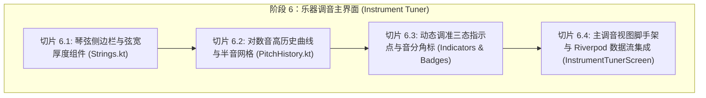

# 会话交接备忘录 (Session Handoff & Context Continuity)

> **交接时间**: 2026-10-31  
> **会话状态**: 【阶段 1~5】已 100% 全部完成并验证，全量 227 项自动化测试全部通过，工作区纯净。  
> **下一目标**: 启动【阶段 6：乐器调音主界面 (Instrument Tuner)】之【切片 6.1：琴弦侧边栏与弦宽厚度组件 (Strings.kt)】。

---

## 一、双端工作区与 Git 现状

1. **Kotlin 原版工程 (事实标准来源)**:
   - 路径: `/Users/huzongyao/flutterProjects/Tuner`
   - 当前分支: `feature/advanced-pitch-algorithms`
   - HEAD Commit: `d570fa9` ("feat(dsp): implement modular pitch engines (MPM, TWM, pYIN) with full settings UI")
   - 状态: 纯净未受任何改动（保护性零污染），测试套件 40 个类 189 项用例全部通过，detekt 静态检查零告警。
2. **Flutter 重构工程 (重构目标仓库)**:
   - 路径: `/Users/huzongyao/flutterProjects/tuner_flutter`
   - 当前分支: `feature/rollback`
   - 当前最新检出 Commit: `c6e1eaa` ("feat(audio): implement MicrophoneAudioSource with hardware capture and lifecycle handling (slice 5.4)")
   - 工作区状态: 静态分析 `flutter analyze` 零告警 (0 issues)，格式化规范 `dart format` 合规，自动化测试 **227 项用例 100% 全部通过**。
   - 历史探索分支: `main`（保留历史记录供查阅，禁止盲目复用）。

---

## 二、建立的持久化交接文档结构

所有规划、矩阵与规范已完整持久化至 `tuner_flutter` 仓库中：

```text
tuner_flutter/
├── AGENTS.md                          # 多 Agent 协同与铁律规范 (纯单切片推进、三道门禁、零污染)
├── docs/
│   ├── audit_and_migration_plan.md    # 基础审计与完整迁移规划白皮书 (85 项功能全景路线图)
│   ├── feature_matrix.md              # 85 项双端功能全量追踪矩阵 (34 项已 VERIFIED, 9 项已部分实现/单测)
│   ├── architecture.md                # 现代化 Clean Architecture 架构设计
│   ├── algorithm_specification.md     # 核心 DSP 算法数学规格书 (FFT, MPM, TWM, Jacobsen, PV 等)
│   ├── known_issues.md                # 原版与历史尝试 Bug 追踪清单 (FORK-NEW-02, ACOUSTIC-01~03 等)
│   ├── migration_status.md            # 当前迁移进度基线与下一任务定义
│   ├── decisions.md                   # 架构与技术决策记录 (ADR-01 ~ ADR-12)
│   └── session_handoff.md             # 本会话交接备忘录
├── test/
│   ├── unit/                          # 单元测试目录 (纯数学、DSP、滤波器与音频流单测: 147 项)
│   ├── domain/                        # 乐理测试 (音符、律制、延展调音、Scala、乐器单测: 88 项)
│   ├── widget/                        # 组件与视图渲染测试 (M3 主题脚手架烟雾测试: 1 项)
│   ├── integration/                   # 端到端测试
│   └── regression/                    # 回归测试
└── lib/
    ├── core/                          # 基础常量、主题扩展、语义颜色
    ├── audio/                         # 音频接口层、环形缓冲区、Isolate 后台并发与硬件采集 (全量完成)
    │   ├── audio_source_interface.dart
    │   ├── mock_audio_source.dart
    │   ├── ring_buffer.dart / audio_ring_buffer.dart
    │   ├── audio_messages.dart
    │   ├── audio_processing_isolate.dart
    │   └── microphone_audio_source.dart
    ├── domain/                        # 纯 Dart 乐理模型、律制与调音实体 (全量完成)
    │   ├── models/                    # MusicalNote, TuningState, TuningTarget, DspEnums
    │   ├── tuning/                    # TuningMath, MusicalScaleFrequencies, FrequencyToNoteConverter
    │   ├── temperaments/              # RationalNumber, 12-EDO, 19种历史良律, CustomTemperament
    │   ├── stretch_tuning/            # StretchTuning, Railsback 32散点钢琴曲线
    │   ├── scala/                     # ScalaParser, ScalaSerializer (.scl & .kbm), KeyboardMapping
    │   └── instruments/               # 15种预设乐器, TargetNoteAutoDetection, InstrumentIO
    └── dsp/                           # 纯 Dart DSP 多引擎架构 (全量完成)
        ├── fft/                       # Radix-2 FFT/IFFT 与 FrequencySpectrum
        ├── windowing/                 # Tophat / Hanning / Hamming 窗函数与能量补偿
        ├── correlation/               # 维纳-辛钦频域零填充自相关与数据缓冲
        ├── pitch/                     # MPM, TWM, Classic, Jacobsen 插值, 抛物线拟合
        ├── filters/                   # IEC 61672-1 计权, 三阶中值滤波, 八度门控, 离群点平滑
        └── pipeline/                  # TunerDspPipeline 统一调音管线门面
```

---

## 三、阶段 1 至阶段 5 已验证成果审计与就绪度分析

项目严格按单切片渐进式原则，历经 18 个功能切片，交付了极其扎实的纯 Dart 领域引擎与底层管道基础设施，**全量 227 项测试 100% 通过**：

### 1. 阶段 1~2：基础架构、M3 主题与代码规范 (1 项 Widget 烟雾测试)
- 建立了基于 Clean Architecture 的工程架构规范与三道质量门禁；
- 实现了 `TunerColors`、`TunerTheme` 与 ThemeExtension 声学语义颜色扩展（准音绿、偏低橙、偏高紫），全面支持 Light/Dark/PureBlack 模式。

### 2. 阶段 3：纯 Dart DSP 多引擎算法体系 (切片 3.1 ~ 3.7，78 项单元测试，全部 VERIFIED)
- **Radix-2 FFT/IFFT (`fft.dart`)**: Cooley-Tukey 算法，修复 `FORK-NEW-02` 原地自覆盖缺陷与虚部相位符号错误；
- **窗函数与自相关 (`windowing.dart`, `correlation.dart`)**: 零填充 $2N$ 规避圆周卷积混叠，位反转直充与波形归一化；
- **抛物线拟合与声学计权 (`polynomial_fit.dart`, `acoustic_weighting.dart`)**: 二次插值求极值，IEC 61672-1 A/C 计权衰减 50Hz 工频电声学干扰；
- **MPM 引擎 (`mcleod_pitch_method.dart`)**: NSDF 归一化平方差与 0.85 首峰阈值比率，攻克小提琴高次谐波八度倍频缺陷 (BUG-04/ACOUSTIC-02)；
- **TWM 引擎 (`two_way_mismatch.dart`)**: Maher & Beauchamp 谐波失配误差与刚度 $B$ 色散补偿，攻克大提琴粗弦基频缺失虚拟音高难题 (BUG-05/ACOUSTIC-03)；
- **经典自相关与 Phase Vocoder (`classic_pitch_detector.dart`, `accurate_spectrum_peak.dart`)**: 次谐波多重惩罚、ACOUSTIC-01 15% 零延迟能量门限、Jacobsen 3-bin 插值与跨帧相位展开；
- **时域滤波与统一调度门面 (`pitch_temporal_filter.dart`, `outlier_removing_smoother.dart`, `tuner_dsp_pipeline.dart`)**: 3-tap 滑动中值滤波、八度跳变折叠门控、多缓冲离群点平滑器。

### 3. 阶段 4：乐理模型、19 种律制与乐器体系 (切片 4.1 ~ 4.6，88 项单元测试，全部 VERIFIED)
- **频率与对数音阶转换 (`frequency_to_note_converter.dart`, `musical_scale_frequencies.dart`)**: A4 基准可调，对数二分查找与插值，0.6 迟滞门控消除临界半音抖动；
- **律制与 12-EDO / N-EDO (`rational_number.dart`, `equal_temperament.dart`)**: 不可变分数模型与微音差五度修正项；
- **19 种欧洲历史良律与纯律 (`predefined_temperament.dart`, `chain_of_fifths.dart`)**: 五度链折叠算法，支持动态根音切换；
- **Railsback 延展调音 (`stretch_tuning.dart`)**: 32 散点经典钢琴延展曲线，对数分段线性插值与几何外推；
- **Scala (.scl & .kbm) 解析与导出 (`scala_parser.dart`, `scala_serializer.dart`, `custom_temperament.dart`)**: 纯律分数/小数混合解析，音符名称绑定与双向往返序列化；
- **15 种预设乐器与智能琴弦匹配 (`predefined_instruments.dart`, `target_note_auto_detection.dart`, `instrument_io.dart`)**: 吉他/贝斯/提琴四重奏/尤克里里，60% 迟滞带与极值弦无界覆盖。

### 4. 阶段 5：平台音频采集与 Isolate 并发管道 (切片 5.1 ~ 5.4，61 项单元测试，全部 VERIFIED)
- **音频输入抽象与模拟流发生器 (`audio_source_interface.dart`, `mock_audio_source.dart`)**: 强类型错误与状态流，纯 Dart 内存多波形连续相位发生器；
- **无锁环形采样缓冲队列 (`audio_ring_buffer.dart`)**: 定长环形缓冲、滑动时窗重叠提取、最新采样快照只读克隆、欠载零填充；
- **Isolate 后台计算与双向消息总线 (`audio_processing_isolate.dart`, `audio_messages.dart`)**: 密集计算 100% 移出 UI 主线程，动态热更算法参数，60 FPS 高精度 UI 节流器；
- **平台真实麦克风硬件驱动 (`microphone_audio_source.dart`)**: 基于 `record: ^7.1.2` 插件采集 44.1kHz 16-bit PCM，显式关闭系统 AGC/AEC/ANS 保留乐器泛音，字节非对齐容错归一化，绑定 `WidgetsBindingObserver` 实现切后台自动休眠与前台自动唤醒。

---

## 四、阶段 6：乐器调音主界面 (Instrument Tuner) 任务拆解与设计规划

在完成底层算法与数据管道后，重构正式进入**用户可见的核心界面呈现阶段**。本阶段严格对标 Kotlin 原版 `ui/instruments/Strings.kt`、`ui/tuning/PitchHistory.kt` 与 `ui/screens/InstrumentTuner.kt`，拆分为 4 个单切片推进：



### 切片 6.1: 琴弦侧边栏与弦宽厚度组件 (Strings.kt) (下一会话首要任务)
- **Kotlin 源码对标**: `/Users/huzongyao/flutterProjects/Tuner/app/src/main/java/de/moekadu/tuner/ui/instruments/Strings.kt` (738 行)
- **核心逻辑与规范**:
  1. **琴弦粗细计算公式 (`computeStringLineWidth`)**:
     $$\text{relativeWidth} = \frac{\text{index} - \text{minIndex}}{\text{maxIndex} - \text{minIndex}}$$
     $$\text{lineWidth} = (\text{maxLineWidth} - \text{minLineWidth}) \times (1 - \text{relativeWidth}) + \text{minLineWidth}$$
     低音弦（小索引）粗、高音弦（大索引）细；单弦或极值退化时取算术平均值。
  2. **弦组与色阶模式**:
     - `strings != null`: 乐器专用琴弦模式（如吉他 6 弦，包含弦名、音阶索引、独立物理粗细）；
     - `strings == null`: 自由半音模式（Chromatic Mode），自动展示当前调音音阶内的全部半音。
  3. **高亮与调准状态响应**:
     - 支持 `highlightedNote` 与 `highlightedNoteKey`；
     - 结合 `TuningState` 显示语义背景色（准音显绿、偏低显橙、偏高显紫）。
  4. **滚动与居中状态机 (`StringsScrollMode`)**:
     - `Automatic`: 随检测音高自动动画平滑滚动使当前弦居中；
     - `Manual`: 用户手动滑动时脱离自动吸附，浮现“回中图标按钮”(`ScrollCenterIcon`)；
     - 多音同名时浮现“切换下一同名弦”(`ScrollNextIcon`)。
  5. **布局与手势**:
     - 支持侧栏位置配置 (`StringsSidebarPosition.Start` 或 `End`)；
     - 点击琴弦触发选中或锁定目标音 (`onStringClicked`)。
- **交付物**:
  - `lib/ui/instruments/strings_widget.dart`
  - `lib/ui/instruments/string_line_width.dart`
  - `test/widget/strings_widget_test.dart`

### 切片 6.2: 对数音高历史轨迹与半音网格组件 (PitchHistory.kt)
- **Kotlin 源码对标**: `ui/tuning/PitchHistory.kt` (510 行)
- **核心逻辑**:
  - Y 轴对数半音网格标尺（基于 `MusicalScaleFrequencies`，半音线等间距，八度线加粗，背景微调色）；
  - 双缓冲平滑时间轴滚动（1s ~ 10s 可配窗口）；
  - 针对静音或丢帧（`frequency <= 0`）优雅断开折线，绝不发生飞线穿屏。
- **交付物**: `lib/ui/tuning/pitch_history_widget.dart`, `lib/ui/tuning/note_grid_painter.dart` 及对应测试。

### 切片 6.3: 动态调准三态指示点与音分角标 (Indicators & Badges)
- **Kotlin 源码对标**: `ui/tuning/PitchHistory.kt` 中的指示器与 `InstrumentTuner.kt`
- **核心逻辑**:
  - 浮动在最新采样点上的调谐圆点；
  - 动态三角形方向指示箭头（音偏低向上指、偏高向下指）；
  - 带有抗锯齿微型气泡的音分读数文本（如 `+5 ct`, `-12 ct`）；
  - 准音容限虚线带（$\pm 3$ 音分）高亮通道。
- **交付物**: `lib/ui/tuning/tuning_indicator.dart` 及对应测试。

### 切片 6.4: 乐器调音主界面脚手架与 Riverpod 数据流集成
- **Kotlin 源码对标**: `ui/screens/InstrumentTuner.kt` (731 行), `InstrumentTunerViewModel.kt`
- **核心逻辑**:
  - 创建 Riverpod `TunerStateNotifier` 接入 `AudioProcessingIsolate` 的输出流，将实时频点与 `TargetNoteAutoDetection`、`TuningState` 绑定；
  - 组合顶部 AppBar（A4 基准调节、升降号切换、律制选择入口、乐器入口）+ 主视口（琴弦侧边栏 + 音高历史画布）；
  - 处理屏幕旋转与横竖屏适配。
- **交付物**: `lib/state/tuner_state_provider.dart`, `lib/ui/screens/instrument_tuner_screen.dart` 及集成测试。

---

## 五、新会话启动提示词 (Prompt for Next Session)

在新会话启动时，请直接发送以下提示词，即可无缝恢复上下文并启动【阶段 6 / 切片 6.1】：

```text
你好！我们正在进行将开源 Android Kotlin 调音器（/Users/huzongyao/flutterProjects/Tuner，分支 feature/advanced-pitch-algorithms）渐进式重构为 Flutter 应用（/Users/huzongyao/flutterProjects/tuner_flutter，分支 feature/rollback）的项目。

在上一会话中，我们已经顺利完成了【阶段 1~5】的全部开发与验证（包含纯 Dart DSP 多引擎、乐理与 19 种律制体系、音频无锁环形缓冲、Isolate 并发总线及真实麦克风驱动），全量 227 项自动化测试 100% 全部通过，工作区纯净。

请首先阅读以下关键文档建立上下文：
1. /Users/huzongyao/flutterProjects/tuner_flutter/AGENTS.md
2. /Users/huzongyao/flutterProjects/tuner_flutter/docs/session_handoff.md
3. /Users/huzongyao/flutterProjects/tuner_flutter/docs/migration_status.md
4. /Users/huzongyao/flutterProjects/tuner_flutter/docs/feature_matrix.md
5. /Users/huzongyao/flutterProjects/tuner_flutter/docs/decisions.md

在确认环境与 Git 状态纯净后，请严格遵循单切片渐进式原则，开始执行【阶段 6 / 切片 6.1：琴弦侧边栏与弦宽厚度组件 (Strings.kt)】的实现与 Widget/单元测试。对标 Kotlin 源码 `/Users/huzongyao/flutterProjects/Tuner/app/src/main/java/de/moekadu/tuner/ui/instruments/Strings.kt`。全部测试通过并创建提交检查点后，请立即停止并汇报，等待我的审查。
```
