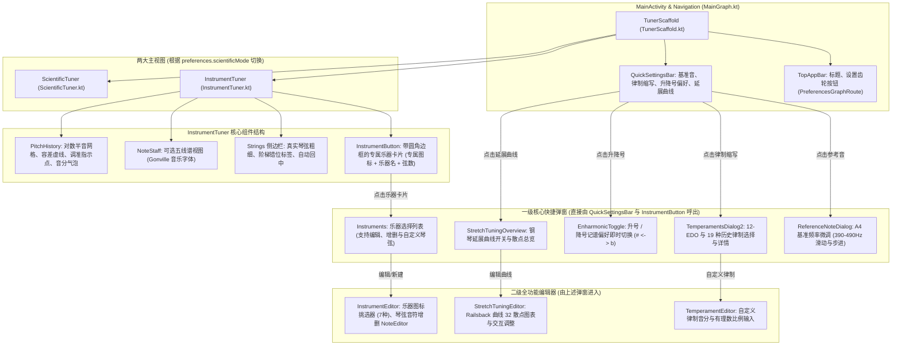

# Tuner 现代化 UI 架构与全功能复刻白皮书 (UI Architecture & Reconstruction Plan)

> **基线状态**: 当前分支已安全回滚至 Stage 1~5 刚完成的纯净提交点 `def38d1`，纯 Dart DSP 算法、19 种律制数学体系、音频无锁环形队列与 Isolate 并发管道已全量就绪 (227/227 项单测 100% 通过)。  
> **核心目标**: 彻底杜绝“仅完成底层算法却在 UI 上偷工减料/缺失入口”的现象，1:1 深度复刻 Android Kotlin 原版（`feature/advanced-pitch-algorithms`）的全部视觉组件、交互弹窗与二级管理页面。

---

## 一、Kotlin 原版 UI 架构全景与组件调用链



---

## 二、此前界面实现的致命缺失点排查 (Gap Analysis)

在上一轮探索中，存在以下严重缺失，本轮重构必须全部逐一歼灭：

1. **缺失底部声学状态栏 (`QuickSettingsBar`)**:
   - 原版在首页底部常驻显示 `A4 440.0 Hz`、`EDO 12`（当前律制）、`♯/♭` 切换按钮与延展调音状态。
   - 上一轮探索错误地用 MD3 页面切换标签栏覆盖了底栏，导致用户**完全无法在首页切换 19 种律制，也无法一键切换升降号**。
2. **缺失顶部乐器卡片 (`InstrumentButton`) 与 7 种专属乐器矢量图标**:
   - 原版拥有专属矢量图标：吉他 (`ic_guitar.xml`)、电吉他 (`ic_eguitar.xml`)、贝斯 (`ic_bass.xml`)、低音提琴 (`ic_double_bass.xml`)、小提琴 (`ic_violin.xml`)、尤克里里 (`ic_ukulele.xml`)、钢琴 (`ic_piano.xml`)。
   - 上一轮探索草率地使用 `Icons.music_note` 占位，且未实现原版带轮廓线的大号乐器卡片。
3. **缺失乐器管理与琴弦编辑器 (`Instruments.kt`, `InstrumentEditor.kt`)**:
   - 上一轮仅在 AppBar 做了一个临时的 6 项静态列表弹窗，完全无法添加自定义乐器、修改琴弦或选择图标。
4. **缺失律制选择弹窗与详情图表 (`TemperamentsDialog2.kt`, `TemperamentDetailsDialog.kt`)**:
   - 算法层支持 19 种欧洲古典律制与有理数五度链，但 UI 上没有列表弹窗、五度圈图表或音分偏离说明。
5. **缺失科学调音双向联动**:
   - 科学示波器应与乐器调音共享同一套 `QuickSettingsBar` 和底层 Isolate 计算，支持一键导出 WAV 录音并保持后台音频连续推流。

---

## 三、UI 渐进式施工切片规划 (Phases 6 ~ 8)

为了严格遵守单切片渐进式原则，后续 UI 施工将按如下 7 个边界清晰的切片推进：

```text
阶段 6：核心声学调音组件与主屏脚手架 (Core Tuner Components & Home)
├── 切片 6.1: 乐器专属矢量图标库 (7种) 与顶部乐器卡片 (InstrumentButton)
├── 切片 6.2: 琴弦粗细物理侧边栏与半音网格对数音高历史曲线 (Strings & PitchHistory)
├── 切片 6.3: 底部声学状态栏 (QuickSettingsBar) 与升降号一键切换
└── 切片 6.4: 19 种历史律制选择弹窗 (TemperamentDialog2) 与 A4 基准音调节

阶段 7：乐器系统与科学调音视图 (Instrument Management & Scientific Mode)
├── 切片 7.1: 全功能乐器管理与琴弦编辑器 (Instruments & InstrumentEditor)
├── 切片 7.2: 实时 FFT 功率谱、自相关波形与 WAV 录音导出 (Scientific Tuner)
└── 切片 7.3: 双视图切换与全局偏好设置面板 (PreferencesScreen & M3 Navigation)
```

### 切片 6.1: 乐器专属矢量图标库与顶部卡片 (InstrumentButton)
- **对标文件**: `ui/instruments/InstrumentButton.kt`, `res/drawable/ic_guitar.xml` 等 7 款图标。
- **任务目标**:
  - 实现纯 Dart 矢量/CustomPainter 乐器图标库（吉他、电吉他、贝斯、低音提琴、小提琴、尤克里里、钢琴）；
  - 实现 M3 风格的 `InstrumentButton` 组件：包含当前乐器图标、乐器名称、定弦音阶摘要、圆角边框及调律兼容性告警标识。
- **验收标准**: 单测验证图标解析，Widget 测试验证卡片渲染与点击回调。

### 切片 6.2: 琴弦物理侧边栏与对数音高历史轨迹 (Strings & PitchHistory)
- **对标文件**: `ui/instruments/Strings.kt`, `ui/tuning/PitchHistory.kt`, `ui/plot/Point.kt`
- **任务目标**:
  - 侧边栏：低音粗高音细弦线反比计算、阶梯错位标签、自动平滑居中与手动滚动解除吸附；
  - 历史曲线：对数半音网格、$\pm 1.5$ 动态平滑视口、丢帧静音断开防飞线、三态指示圆点（准音绿光晕、偏低向上三角、偏高向下三角）与音分气泡徽章。
- **验收标准**: 单元测试覆盖几何公式与数据容器，Widget 测试验证画布渲染与断线逻辑。

### 切片 6.3: 底部声学状态栏 (QuickSettingsBar) 与升降号切换
- **对标文件**: `ui/misc/QuickSettingsBar.kt`, `ui/misc/TunerScaffold.kt`
- **任务目标**:
  - 还原常驻底栏 `QuickSettingsBar`；
  - 包含 A4 基准音单元格（显示如 `A4 440.0 Hz`）；
  - 包含律制缩写单元格（显示如 `EDO 12`、`Werck. III`、`Pythag.`）；
  - 包含记谱偏好单元格（显示 $\sharp$ 或 $\flat$ 图标，轻触即时全局切换）；
  - 包含延展调音单元格（开启时显示曲线名）。
- **验收标准**: Widget 测试验证各单元格显示、点击事件派发与升降号切换响应。

### 切片 6.4: 19 种历史律制选择弹窗与主界面装配 (TemperamentDialog2 & InstrumentTunerScreen)
- **对标文件**: `ui/temperaments/TemperamentDialog2.kt`, `ui/screens/InstrumentTuner.kt`
- **任务目标**:
  - 点击底栏律制单元格时，弹出 `TemperamentDialog2`，完整罗列 12-EDO 及全部 19 种欧洲古典律制；
  - 选中律制后，即时更新 `MusicalScaleFrequencies`，全局重算所有琴弦目标音高；
  - 完成主调音界面 `InstrumentTunerScreen` 的整体装配，串联底层 Isolate 音频流与实时测频。
- **验收标准**: Widget 测试验证弹窗选择律制后，琴弦基准频率与调音判定即时联动更新。

### 切片 7.1: 全功能乐器管理与琴弦编辑器 (Instruments & InstrumentEditor)
- **对标文件**: `ui/instruments/Instruments.kt`, `ui/instruments/InstrumentEditor.kt`, `InstrumentIconPicker.kt`
- **任务目标**:
  - 点击顶部 `InstrumentButton` 弹出或跳转全量乐器列表；
  - 支持从预设乐器复制、重命名、增删琴弦、挑选专属乐器矢量图标；
  - 接入 `InstrumentIO` 格式，支持本地持久化保存与恢复默认。
- **验收标准**: 增删改查乐器全流程自动化 Widget 测试。

### 切片 7.2: 科学调音界面与 WAV 录音导出 (ScientificTuner & WaveWriter)
- **对标文件**: `ui/screens/ScientificTuner.kt`, `FrequencyPlot.kt`, `CorrelationPlot.kt`, `WaveWriter.kt`
- **任务目标**:
  - 竖屏与横屏自适应科学示波器：实时 FFT 频谱峰值图、自相关时延波形图、对数历史网格图；
  - 支持单指平移与双指缩放，双击复位视口；
  - 浮动按钮一键将环形缓冲无缝冻结导出为标准 RIFF WAV 文件并弹出分享/提示。
- **验收标准**: 图表视口计算单测与 WAV 字节合规性测试。

### 切片 7.3: 偏好设置面板与全景系统贯通 (PreferencesScreen & Navigation)
- **对标文件**: `ui/screens/Preferences.kt`, `ui/preferences/*.kt`
- **任务目标**:
  - 分组式 M3 设置页面：测频算法引擎切换 (Classic / MPM / TWM)、窗函数、声学计权 (A/C)、主题模式 (Light / Dark / PureBlack)、屏幕常亮与“恢复出厂设置”；
  - 串联双屏无缝切换，保证后台音频与测频计算绝对不中断。
- **验收标准**: 全系统端到端集成测试通过。

---

## 四、核心开发铁律重申 (Non-Negotiable Principles)

1. **禁止用“算法写完”冒充“功能完成”**:
   - 每一个功能必须在屏幕上有明确、高保真、可操作的 UI 入口。
2. **严禁使用通用占位符敷衍专属设计**:
   - 乐器图标必须有专属矢量图，底栏声学状态必须清晰完整，禁止简省。
3. **三道门禁不可妥协**:
   - 每次提交前必须通过：`dart format`、`flutter analyze` (零告警)、`flutter test` (100% 通过)。
